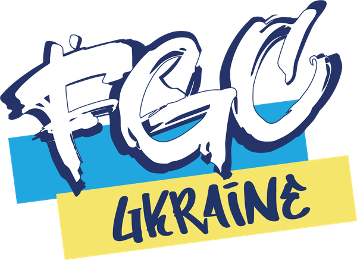
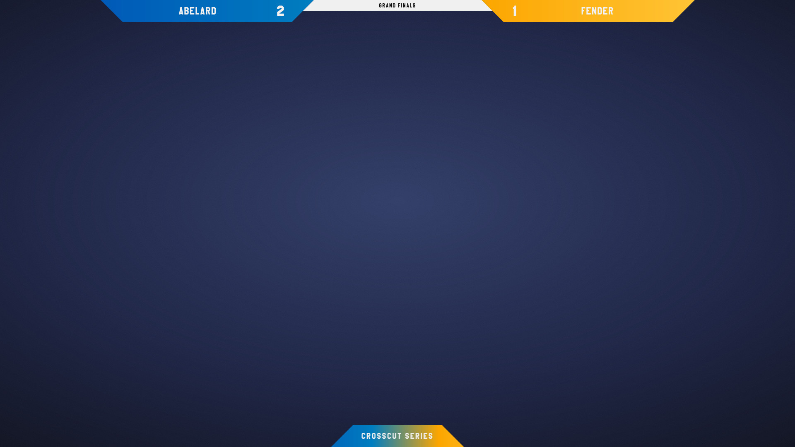
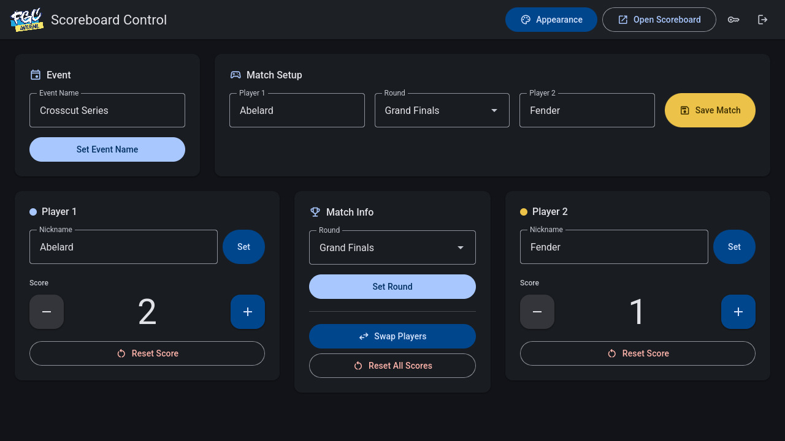
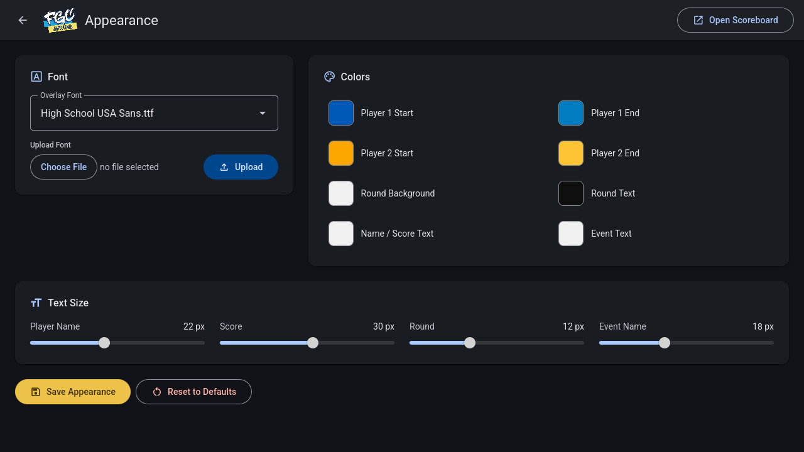

<p align="center"></p>

# FGC Ukraine Scoreboard

[](LICENSE)

> Made in Ukraine. Using this project or its source code requires that you condemn russia's war of aggression against Ukraine — see [LICENSE](LICENSE).

> **Support Ukraine:** donate to [United24](https://u24.gov.ua/), [Come Back Alive](https://savelife.in.ua/en/) and [FGC Ukraine](https://fightingua.donatik.ua).

Real-time fighting game scoreboard overlay for OBS, built with FastAPI and WebSockets.



---

## Quick Setup

```bash
./setup.sh
```

By default this creates a `.venv`, installs the dependencies and sets the admin password; then start the server with `.venv/bin/python run.py`. With `./setup.sh --docker` (or by choosing Docker when asked) it builds the image, sets the password and runs the app in a container instead. Either way it can also, if you ask, add your domain to an installed Caddy for automatic HTTPS (see the optional HTTPS section below). The manual steps are below.

On Windows (PowerShell):

```powershell
powershell -ExecutionPolicy Bypass -File .\setup.ps1
```

This does the same as `setup.sh` (a `.venv` by default; `-Docker`, or choosing Docker when asked, uses Docker Desktop instead) but without the Caddy/HTTPS step. Start the server with `.venv\Scripts\python.exe run.py`. `-ExecutionPolicy Bypass` is needed because Windows' default policy blocks unsigned local scripts.

---

## Prerequisites

- Python 3.10+ (or Docker, see [Optional: Docker](#optional-docker))
- OBS Studio (for overlay use — set browser source to 1920×1080, transparent background)

---

## Dependencies

```bash
pip install -r requirements.txt
```

---

## Password Setup

On first launch, open `/control`: while no password exists it redirects to `/setup`, where you choose the admin password (min. 8 characters). Setup is open to anyone until a password exists, so do it before exposing the server. Afterwards the password can be changed from the key icon in the control panel; changing it logs out all other sessions.

To set or reset the password from the command line (also the recovery path for a lost password):

```bash
python3 setup_password.py
```

The password hash and JWT secret key are stored in `scoreboard.db`. No config files needed.

---

## Configuration

| Variable | Default | Description |
|----------|---------|-------------|
| `DB_PATH` | `scoreboard.db` | SQLite database (password hash, JWT secret, state, caches) |
| `FONTS_DIR` | `fonts/` next to the database | Directory for uploaded fonts |

---

## Start

### Run

```bash
python3 run.py
```

Listens on `http://localhost:8000` by default. Use `--host` / `--port` to change the bind address:

```bash
python3 run.py --host 127.0.0.1 --port 8000
```

### Optional: Docker

Instead of a Python install you can run the app in a container. All data (database and uploaded fonts) lives in the `fgc-data` volume:

```bash
docker build -t fgc-scoreboard .
docker run --rm -it -v fgc-data:/data fgc-scoreboard setup_password.py
docker run -d --name fgc-scoreboard --restart unless-stopped -p 8000:8000 -v fgc-data:/data fgc-scoreboard
```

The password can also be set in the web UI at `/setup`. If you put a reverse proxy in front (next section), publish the port on loopback only: `-p 127.0.0.1:8000:8000`.

Logs and lifecycle: `docker logs -f fgc-scoreboard`, `docker stop fgc-scoreboard`, `docker start fgc-scoreboard`.

### Optional: HTTPS with a reverse proxy

TLS is optional. The app speaks plain HTTP, which is fine on a LAN or localhost. If you expose it to the internet, bind it to loopback and put a TLS-terminating reverse proxy in front that forwards WebSockets (`/ws`). Any proxy works; Caddy is just one example:

```bash
python3 run.py --host 127.0.0.1
```

Example with [Caddy](https://caddyserver.com/) (automatic HTTPS), in `/etc/caddy/Caddyfile`:

```
scoreboard.example.com {
	reverse_proxy localhost:8000
}
```

Then reload Caddy:

```bash
sudo systemctl reload caddy
```

### URLs

| URL | Description |
|-----|-------------|
| `/` | Scoreboard overlay (add as OBS browser source) |
| `/control` | Operator control panel |
| `/appearance` | Overlay font and color settings |

---

## Control Panel



**Match Setup** (top strip) — set both player names and round, then press **Save Match** to push everything live and reset scores to 0. Player names and event names are cached in the database and offered as autocomplete suggestions on subsequent matches.

**Score controls** — increment, decrement, or reset individual scores in real time.

**Match Info** — change the round mid-match or swap/reset players without affecting the setup strip.

**Event** — set the event name shown on the bottom overlay bar.

**Appearance** (`/appearance`, linked from the control panel header) — pick the overlay font from the list or upload a `.ttf`, `.otf`, `.woff` or `.woff2` file (max 10 MB; stored in `FONTS_DIR`), set the colors of both player panels (gradient start/end), round panel, and name/score/event text, and the text size (px) of player names, scores, the round and the event name. The bottom bar gradient is derived from the player colors. **Save Appearance** pushes the changes live to the overlay; **Reset to Defaults** restores the original look.



---

## Links

- Author: [@lin_dze on X](https://x.com/lin_dze)
- FGC Ukraine: [@fighting_ua on X](https://x.com/fighting_ua) · [fighting_ua on Twitch](https://www.twitch.tv/fighting_ua)

---

## License

[Stand With Ukraine Share-Alike License 1.0](LICENSE). Every right to use, modify or distribute this project is conditional on condemning russia's war of aggression against Ukraine. Forks and derivative works must be distributed under the same license, unmodified, with source code.

The default overlay font, High School USA Sans, is [freeware by AbdulMakesFonts](https://www.fontspace.com/high-school-usa-font-f16127) and is not covered by this license.
